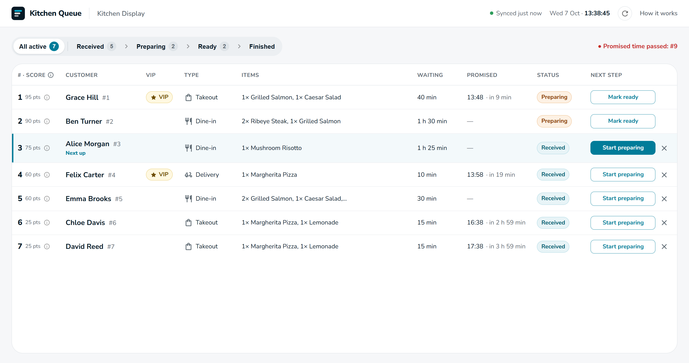
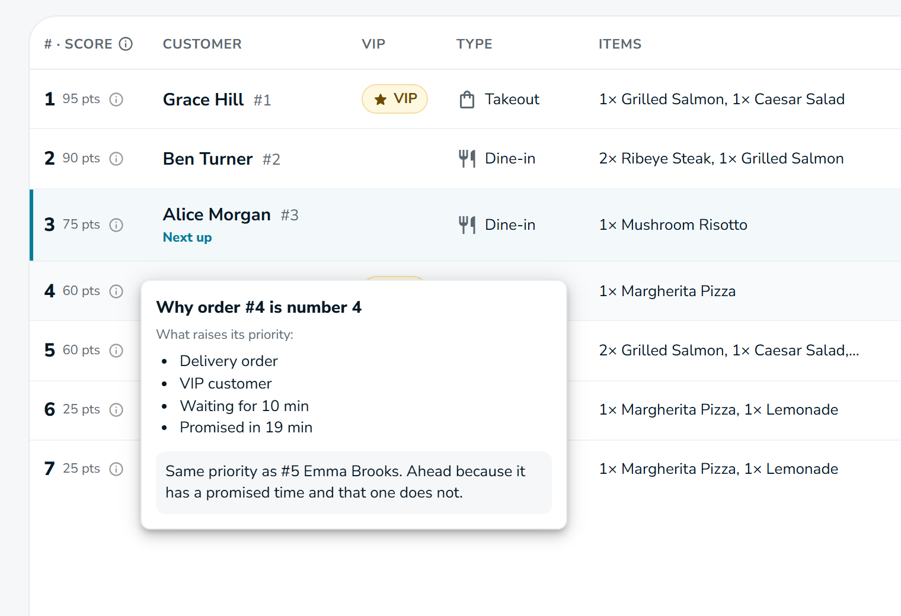
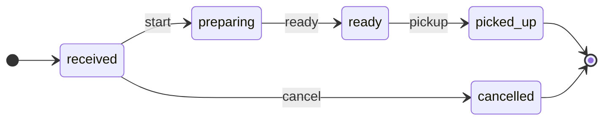
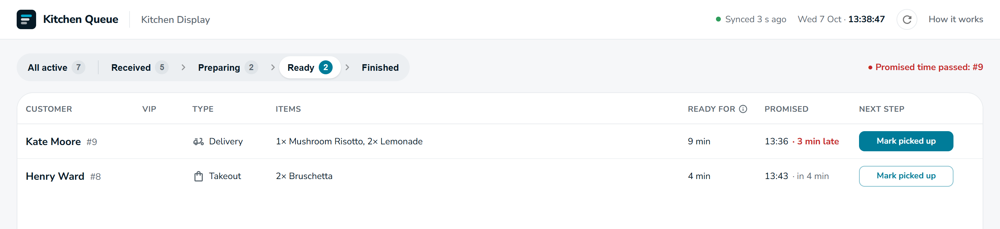
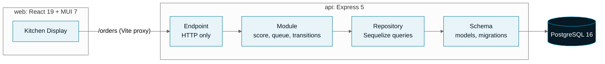

<div align="center">


# Kitchen Queue

**The expeditor's screen for a restaurant kitchen: every active order, ranked by priority, one click from its next stage.**

<p>
  
  
  
  
  
  
  
  <br />
  
  
  
  
  
</p>

[Quick start](#-quick-start) ·
[How ranking works](#-how-ranking-works) ·
[Order lifecycle](#-order-lifecycle) ·
[API](#-api-reference) ·
[Architecture](#-architecture) ·
[Testing](#-testing) ·
[Decisions](DECISIONS.md)

<br />



</div>

<br />

## ✨ Highlights

<table>
  <tr>
    <td width="33%" valign="top">
      <h4>🎯 Ranked by the server</h4>
      Every order gets a priority score computed at request time. The screen renders rows in the order the API returns them and holds no copy of the formula.
    </td>
    <td width="33%" valign="top">
      <h4>🔒 Rules that cannot be bypassed</h4>
      Status changes go through a state machine on the server. Illegal moves return <code>409 INVALID_TRANSITION</code>, even when the API is called directly.
    </td>
    <td width="33%" valign="top">
      <h4>💬 Explains itself</h4>
      Hover any position to see, in plain words, why the order is there and why it is ahead of the next one.
    </td>
  </tr>
  <tr>
    <td valign="top">
      <h4>⚡ Safe under concurrency</h4>
      Transitions use a conditional <code>UPDATE ... WHERE status = &lt;expected&gt;</code>, so two simultaneous clicks cannot both win.
    </td>
    <td valign="top">
      <h4>🧩 Built for change</h4>
      Weights, tie-breaks and transitions each live in one table. The UI renders statuses and actions it has never seen, so server-side changes need no frontend change.
    </td>
    <td valign="top">
      <h4>🔄 Stays current</h4>
      The screen refreshes every 15 seconds, pauses while the tab is hidden and shows when it last synced. An order created through <code>POST /orders</code> shows up on the next refresh.
    </td>
  </tr>
</table>

<br />

<table>
  <tr>
    <td width="52%"></td>
    <td width="48%">
      <h3>Why is this order here?</h3>
      <p>The position cell opens a short explanation built from data the API sends with each order:</p>
      <ul>
        <li>the parts of the score that raised its priority (VIP, waiting time, promised time...)</li>
        <li>the rule that placed it above the next order: a higher score, or a tie-break such as an earlier promised time</li>
      </ul>
      <p>No points or arithmetic are shown. The screen explains the ranking; the formula stays on the server.</p>
    </td>
  </tr>
</table>

<br />

## 🚀 Quick start

### Prerequisites

| Tool | Version | Check |
|---|---|---|
| [Docker](https://docs.docker.com/get-docker/) | with Compose v2 | `docker compose version` |
| [Node.js](https://nodejs.org/) | **22** (see [`.nvmrc`](.nvmrc)) | `node -v` |

### Four commands

```bash
docker compose up -d     # 1. start PostgreSQL 16 on port 5433
npm install              # 2. install the API and the web app (npm workspaces)
npm run db:setup         # 3. run the migrations and load the demo data
npm run dev              # 4. start the API and the web app together
```

Then open **http://localhost:5173**.

| Service | URL | Notes |
|---|---|---|
| Web app | http://localhost:5173 | Vite dev server; proxies `/orders` to the API |
| API | http://localhost:4000 | e.g. `GET /orders/queue` |
| PostgreSQL | `localhost:5433` | user, password and database: `kitchen_queue` |

> [!TIP]
> `npm run db:setup` resets the schema and reseeds with timestamps relative to the current time. Run it again whenever you want the demo back to its initial state.

<br />

## 📜 Scripts

Run from the repository root.

| Command | What it does |
|---|---|
| `npm run dev` | API (`node --watch`, port 4000) and web app (Vite, port 5173) in one terminal |
| `npm run db:setup` | Waits for PostgreSQL, rolls back every migration, migrates and seeds |
| `npm test` | API unit and integration tests, then the web component tests (integration tests need Docker running) |
| `npm run test:unit -w api` | API unit tests only, no database needed |
| `npm test -w web` | Web component tests (Vitest + Testing Library), no API needed |
| `npm run test:e2e` | End-to-end tests in Chromium (Playwright): resets the demo data, then starts the API and the web app if they are not running |
| `npm run lint` | oxlint over the API and the web app |
| `npm run build` | Type-checks (`tsc`) and builds the web app |

<br />

## 🧮 How ranking works

The default queue contains orders that are `received` or `preparing`, sorted by priority score, highest first. The score is computed on each request from the real clock (and from a frozen clock in tests).

| Input | Rule | Points |
|---|---|---|
| Order type | dine-in / takeout / delivery | 30 / 20 / 10 |
| VIP | customer is VIP | +20 |
| Waiting time | `min(40, floor(minutes_waiting / 10) * 5)` | 0 to 40 |
| Promised time | within 30 min / 31 to 60 min / later or none | 25 / 15 / 0 |
| Complexity | `min(20, floor(total_prep_minutes / 15) * 5)` | 0 to 20 |

**Tie-break**, in order: earlier `promised_at` (orders without one go last), then earlier `placed_at`, then lower `id`.

<details>
<summary><b>Edge cases and how they are handled</b></summary>
<br />

| Case | Behaviour |
|---|---|
| 9 min 50 s of waiting | Whole minutes, floored: 9 minutes, 0 points |
| Promise 30 min 59 s away | Floored to 30 minutes: still in the 25-point bucket, so the buckets have no gap |
| Promise already passed | Scores 25: only "more than 60 minutes away or none" scores 0 |
| `placed_at` slightly in the future | Waiting time is clamped at 0 |
| Order type with no weight | The API fails loudly instead of scoring 0 |

</details>

<details>
<summary><b>Worked example from the spec (both orders score 60)</b></summary>
<br />

| | Order A: dine-in, 35 min, 2× salmon + 1× salad | Order B: delivery, VIP, 10 min, promised in 20 |
|---|---|---|
| Type | 30 | 10 |
| VIP | 0 | 20 |
| Waiting | 15 | 5 |
| Promise | 0 | 25 |
| Complexity | 15 (50 min) | 0 (12 min) |
| **Total** | **60** | **60** |

B ranks first: same score, and B has a promised time while A does not. Both cases are unit tests.

</details>

<br />

## 🔁 Order lifecycle



Every other move is rejected with `409 INVALID_TRANSITION`: skipping a step (`received` to `ready`), repeating one (starting an order that is already `preparing`), or leaving a terminal status (`picked_up`, `cancelled`). The rules live on the server; the API sends each order's `allowed_actions`, and the screen only renders those buttons.

The screen follows the same path: **All active · Received › Preparing › Ready › Finished**. *Ready* and *Finished* sit after the kitchen queue, so ready orders can be marked as picked up and finished ones reviewed.



<br />

## 📡 API reference

| Method | Path | Description |
|---|---|---|
| `GET` | `/orders/queue` | Active queue (`received` + `preparing`), ranked. Optional `?status=received` or `?status=preparing` |
| `POST` | `/orders` | Create an order; it starts as `received` with `placed_at` set by the server |
| `POST` | `/orders/:id/start` | `received` → `preparing` |
| `POST` | `/orders/:id/ready` | `preparing` → `ready` |
| `POST` | `/orders/:id/pickup` | `ready` → `picked_up` |
| `POST` | `/orders/:id/cancel` | `received` → `cancelled` |
| `GET` | `/orders/ready` | Ready orders, longest waiting for pickup first |
| `GET` | `/orders/finished` | Last 20 picked-up or cancelled orders, most recent first |

> [!TIP]
> Every request above, including each error case, is ready to run in [`postman/kitchen-queue.postman_collection.json`](postman/kitchen-queue.postman_collection.json). Import it into Postman and run the whole collection in order with the Collection Runner: creating an order saves its id for the lifecycle requests that follow. Each request checks its status code and response.

<details>
<summary><b>Example: one entry of <code>GET /orders/queue</code></b></summary>

```json
{
  "id": 4,
  "customer_name": "Felix Carter",
  "type": "delivery",
  "placed_at": "2026-10-07T16:28:52.417Z",
  "promised_at": "2026-10-07T16:58:52.417Z",
  "is_vip": true,
  "status": "received",
  "status_changed_at": "2026-10-07T16:28:52.417Z",
  "items": [{ "menu_item_id": 4, "name": "Margherita Pizza", "prep_time_minutes": 12, "quantity": 1 }],
  "score": 60,
  "score_breakdown": { "type": 10, "vip": 20, "wait": 5, "promise": 25, "complexity": 0 },
  "wait_minutes": 10,
  "minutes_until_promised": 19,
  "minutes_in_status": 10,
  "allowed_actions": ["start", "cancel"],
  "ahead_of_next": { "order_id": 5, "decided_by": "promised_at" }
}
```

The list is wrapped as `{ "generated_at": "<ISO timestamp>", "orders": [...] }`. Every time value is computed with the same `now` as the score. Transition endpoints return `{ "order": { ... } }` with the updated order.

</details>

<details>
<summary><b>Example: <code>POST /orders</code></b></summary>

```bash
curl -X POST http://localhost:4000/orders \n  -H "Content-Type: application/json" \n  -d '{"customer_name": "Nora Blake", "type": "takeout", "is_vip": false,
       "promised_at": null, "items": [{ "menu_item_id": 1, "quantity": 2 }]}'
```

| Field | Rule |
|---|---|
| `customer_name` | Required, non-empty; surrounding spaces are trimmed |
| `type` | `dine_in`, `takeout` or `delivery` |
| `is_vip` | Boolean, defaults to `false` |
| `promised_at` | ISO 8601 timestamp or `null` (default) |
| `items` | Non-empty list of `{ menu_item_id, quantity }`, both positive integers; every menu item must exist |

Returns `201` with `{ "order": { ... } }`, in the same shape as a queue entry. `status` and `placed_at` are always set by the server; values sent for them are ignored. Every invalid field is reported at once:

```json
{
  "error": {
    "code": "VALIDATION_ERROR",
    "message": "The order is invalid.",
    "details": {
      "errors": [
        { "field": "type", "message": "must be one of: dine_in, takeout, delivery" },
        { "field": "items[0].quantity", "message": "must be a positive integer" }
      ]
    }
  }
}
```

</details>

### Error codes

Every error has the same shape and a stable, machine-readable `code`:

```json
{
  "error": {
    "code": "INVALID_TRANSITION",
    "message": "Cannot start an order that is preparing.",
    "details": { "action": "start", "current_status": "preparing", "allowed_from": ["received"] }
  }
}
```

| Code | HTTP | When |
|---|---|---|
| `INVALID_TRANSITION` | 409 | The move is not allowed from the order's current status, or another request changed it first |
| `ORDER_NOT_FOUND` | 404 | No order with that id |
| `INVALID_ORDER_ID` | 400 | The id is not a positive integer (`abc`, `1.5`, `-3`, `007`) |
| `INVALID_STATUS_FILTER` | 400 | `?status=` is not `received` or `preparing` |
| `VALIDATION_ERROR` | 400 | `POST /orders` body is invalid; `details.errors` lists every field |
| `ROUTE_NOT_FOUND` | 404 | No such route or method |
| `BAD_REQUEST` | 400 | Malformed request, e.g. invalid JSON or URL encoding |
| `INTERNAL_ERROR` | 500 | Unexpected failure; the cause is logged, never returned |

<br />

## 🏛 Architecture

One repository, two apps, managed as npm workspaces.



| Layer | Responsibility | Files |
|---|---|---|
| **Endpoint** | Parse the request, call the module, write the response | `api/src/endpoints` |
| **Module** | Priority score, queue order, state machine; pure functions with `now` passed in | `api/src/modules` |
| **Repository** | Sequelize queries, includes, filters, the conditional status update | `api/src/repositories` |
| **Schema** | Models, migrations (never `sync()`), seed | `api/src/schema` |

<details>
<summary><b>Project structure</b></summary>

```
.
├── api/
│   ├── scripts/wait-for-db.js          # db:setup waits for PostgreSQL to accept connections
│   ├── src/
│   │   ├── endpoints/                  # orders router, error handler
│   │   ├── modules/                    # priority · queue · transitions · new-order · orders.module
│   │   ├── repositories/               # orders.repository.js
│   │   ├── schema/                     # models · migrations · seeders · sequelize-cli config
│   │   ├── app.js · server.js · config.js · errors.js
│   └── tests/
│       ├── unit/                       # pure rules, no database
│       └── integration/                # HTTP + PostgreSQL through supertest
├── web/
│   └── src/
│       ├── api/orders.ts               # API client and types
│       ├── components/                 # tables, cells, status pipeline, dialogs; *.test.tsx next to them
│       ├── hooks/                      # useOrders · useAutoRefresh · useNow
│       ├── format.ts                   # labels and formatting
│       └── theme.ts                    # MUI theme
├── e2e/                                # Playwright end-to-end tests
├── postman/                            # Postman collection for every endpoint
├── docker-compose.yml                  # PostgreSQL 16 only, host port 5433
├── playwright.config.ts
├── DECISIONS.md
└── README.md
```

</details>

<br />

## 🛠 Making a change

Each rule lives in one place, with tests next to it.

| To change | Edit | Then |
|---|---|---|
| A weight, cap or promise bucket | `PRIORITY_RULES` in [`api/src/modules/priority.js`](api/src/modules/priority.js) | Update `api/tests/unit/priority.test.js` |
| The tie-break order, or add a tie-break | `QUEUE_ORDER` in [`api/src/modules/queue.js`](api/src/modules/queue.js) | Update `api/tests/unit/queue.test.js` |
| Which transitions are allowed | `TRANSITIONS` in [`api/src/modules/transitions.js`](api/src/modules/transitions.js) | Update `api/tests/unit/transitions.test.js` |
| Add a status | A migration replacing the `orders_status_valid` CHECK, then `TRANSITIONS` | `npm run db:setup` |

The web app needs no change for any of these: unknown statuses, actions and tie-breaks render with readable labels, and new actions get their own button.

<br />

## ✅ Testing

```bash
npm test                     # API unit + integration, then web component tests (Docker must be running)
npm run test:unit -w api     # API unit tests only, no database
npm test -w web              # web component tests only
npm run test:e2e             # end-to-end in Chromium (resets the demo data first)
```

| Suite | Proves |
|---|---|
| `priority.test.js` | The spec's worked examples, both caps, every promise bucket and its boundaries, a lower-weight type outranking a higher one |
| `queue.test.js` | Ranking, every tie-break, the default queue's statuses, invalid filters, the `ahead_of_next` criterion |
| `transitions.test.js` | All 20 status × action pairs: the 4 legal moves succeed, skipping, repeating and leaving a terminal status are rejected |
| `new-order.test.js` | `POST /orders` validation: defaults, trimming, every invalid field reported at once |
| `orders.module.test.js` | Use cases with a mocked repository, including the lost-race branch and unknown menu items |
| `orders.api.test.js` | HTTP through to PostgreSQL: lifecycle, 409 on a repeated start, cancelled and picked-up orders absent from the queue, creating an order, error codes, concurrent clicks |
| `QueueTable.test.tsx` | The cancel button appears only for orders whose `allowed_actions` include it; clicks report the action; Next up; the empty state |
| `kitchen-queue.spec.ts` | In a real browser: the expeditor starts a seeded order and its status changes to Preparing; an order created through the API appears on the open screen |

- Unit and integration tests never read the real clock: they use a frozen `now` (`2026-06-15T12:00:00Z`, the spec's example time).
- `npm run test:e2e` runs `db:setup` first, so the seeded orders are always in their initial state. The first run downloads Chromium.
- Integration tests run against a separate `kitchen_queue_test` database, created and migrated automatically, and refuse to run against any database whose name does not end in `_test`.

<br />

## 🌱 Demo data

`npm run db:setup` loads a lunch service in progress, with every timestamp relative to the moment it runs:

- all three order types, VIP and non-VIP customers
- an order past the waiting-time cap and one past the complexity cap
- score ties broken by `promised_at`
- orders `received`, `preparing`, `ready`, `picked_up` and `cancelled`

Each order in preparation was the highest-ranked waiting order when it was started, so the history on screen matches the ranking. The seeder lists which row demonstrates each case.

<br />

## ⚙️ Configuration

The defaults match `docker-compose.yml`, so no `.env` file is needed. Any value can be overridden with an environment variable.

| Variable | Default | Used for |
|---|---|---|
| `PORT` | `4000` | API port |
| `DB_HOST` | `localhost` | PostgreSQL host |
| `DB_PORT` | `5433` | PostgreSQL port |
| `DB_USER` / `DB_PASSWORD` | `kitchen_queue` | PostgreSQL credentials |
| `DB_NAME` | `kitchen_queue` | Application database |
| `DB_NAME_TEST` | `kitchen_queue_test` | Integration test database |

<br />

## 🩺 Troubleshooting

<details>
<summary><b><code>Postgres is not reachable</code> during <code>db:setup</code></b></summary>
<br />
Docker is not running or the container has not started. Run <code>docker compose up -d</code> and check <code>docker compose ps</code>. The setup waits up to 30 seconds for the database.
</details>

<details>
<summary><b>Port 5433, 4000 or 5173 is already in use</b></summary>
<br />
Stop the process using it, or change the port: <code>PORT</code> for the API, <code>DB_PORT</code> together with the mapping in <code>docker-compose.yml</code> for PostgreSQL. The web app expects port 5173.
</details>

<details>
<summary><b>Integration tests fail with <code>Integration tests need Postgres</code></b></summary>
<br />
Start the database with <code>docker compose up -d</code>, or run only the unit tests: <code>npm run test:unit -w api</code>.
</details>

<details>
<summary><b>Unexpected install or runtime errors</b></summary>
<br />
Check <code>node -v</code> reports 22. With nvm or fnm, run <code>nvm use</code> or <code>fnm use</code> in the repository root.
</details>

<br />

## 📚 More

- [`DECISIONS.md`](DECISIONS.md): scope, layers, priority, transitions, AI usage and next steps
- [`ai-logs/`](ai-logs/): the AI conversation history
